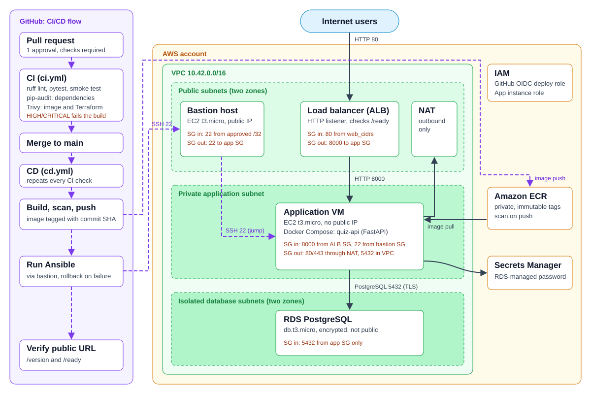

# SomaQuiz

> Exam practice that works on any phone, with or without a smartphone.

[](https://github.com/jacobelohe/Formative1-Project-Foundation-Secure-Collaboration/actions/workflows/ci.yml)
[](https://github.com/jacobelohe/Formative1-Project-Foundation-Secure-Collaboration/actions/workflows/cd.yml)

## Live Application

[Open the live app](http://somaquiz-development-web-1772958576.eu-west-1.elb.amazonaws.com) (HTTP, served by the AWS load balancer). Useful paths: `/docs` (interactive API), `/ready` (database connection), `/version` (deployed commit) and `/stats/math` (data read from the database).

## Video Demo

[Watch the demo video](https://drive.google.com/drive/folders/12WplrfC6lsAXrpigdmr6jyMuEHke4UK_?usp=sharing) (Google Drive folder).

---

## 📋 Team Participation Sheet

> **[👉 View Team Participation Sheet](https://docs.google.com/spreadsheets/d/1T84KL2_JWtcByxihPB16qP5hJUZ8BI4qkjxJ-HTExCI/edit?usp=sharing)**
>
> 📎 Local copy: [SomaQuiz Team Task Sheet - Final Project.xlsx](SomaQuiz%20Team%20Task%20Sheet%20-%20Final%20Project.xlsx)

---

## African Context

Millions of secondary-school students across Africa sit national exams (WAEC, KCSE, NECTA, Rwanda National Exams, and others), yet quality past-paper practice is expensive, scattered across heavy PDFs, or locked behind costly data bundles. Many students own only a low-end or feature phone, and phones are often shared within a household. SomaQuiz offers lightweight quizzes with instant marking and explanations, delivered through a small web app **and** a USSD-style text menu that needs no smartphone and almost no data. ("Soma" means "read/study" in Swahili.)

## Team Members

| Name | Role | GitHub | Student ID |
|---|---|---|---|
| Jacob Ndayishimiye | Team lead: repo security, CI/branch rules, continuous deployment, documentation | [@jacobelohe](https://github.com/jacobelohe) | _add_ |
| Joshua Ochel Mugisha | Backend: quiz API and scoring; AWS infrastructure (Terraform) | [@Mugisha-Joshua](https://github.com/Mugisha-Joshua) | _add_ |
| Ewing Keylan | USSD menu, tests; security scanning and readiness checks | [@Zoulou1](https://github.com/Zoulou1) | _add_ |
| Olaniyi Olufemi | DevOps: Docker, first CI workflow and Terraform skeleton; Ansible host security | [@olaniyiolufemi](https://github.com/olaniyiolufemi) | _add_ |

## Architecture Overview



Solid lines are runtime traffic and dashed purple lines are delivery. Red text lists the security group rules.

| Component | Purpose | Reached from |
|---|---|---|
| Load balancer (public subnets) | The only public web entry point; health checks `/ready` | Internet, port 80 |
| Bastion host (public subnet) | SSH jump host for Ansible and operators | Approved `/32` addresses, and the CD runner during a deployment |
| Application VM (private subnet) | Runs the API container with Docker Compose; no public IP | Load balancer on 8000, bastion on 22 |
| RDS PostgreSQL (isolated subnets) | Stores quiz attempts | Application VM, port 5432 |
| ECR | Private registry with immutable, commit-tagged images | Deploy role pushes, VM role pulls |
| NAT gateway | Outbound package, image and Secrets Manager access for the VM | Application subnet |

## Project Overview

SomaQuiz lets a student pick a subject, answer a short set of multiple-choice questions, and receive a score with an explanation for every answer. The same quiz engine is exposed over HTTP (for a web front end) and through a USSD-style text menu so students on feature phones can practise too.

The code is organised as small, independent services (`quiz-api`, `ussd-gateway`) behind clear interfaces, so each can be containerised and scaled separately as the project grows.

### Target Users
- Secondary-school students preparing for national exams, especially on low-end or shared phones and limited data.
- Teachers who want to add and curate question banks for their class.

### Core Features
- **Subject list**: browse available subjects.
- **Quiz generation**: get N random questions for a subject.
- **Instant scoring**: submit answers and receive a score plus per-question explanations.
- **USSD-style menu**: navigable text menu (2+ levels) for feature phones.
- **Subject stats**: attempts and average score per subject, stored in PostgreSQL.

## Technology Stack

- **Backend**: Python 3.12, FastAPI
- **Cloud**: AWS
- **Database**: PostgreSQL on RDS for quiz attempts; the question bank is JSON
- **Container registry**: Amazon ECR
- **Infrastructure as code**: Terraform
- **Configuration management**: Ansible
- **CI/CD**: GitHub Actions, with pytest, ruff, pip-audit and Trivy

## Run Locally

### Prerequisites
- Python 3.12+
- Git
- Docker with Compose v2 (optional, to run in a container; see [Run with Docker Compose](#run-with-docker-compose))

### Installation

1. Clone the repository
```bash
git clone git@github.com:jacobelohe/Formative1-Project-Foundation-Secure-Collaboration.git
cd Formative1-Project-Foundation-Secure-Collaboration
```

2. Install dependencies
```bash
cd services/quiz-api
python -m venv .venv && source .venv/bin/activate
pip install -r requirements.txt
cp ../../.env.example ../../.env
```

3. Run the application
```bash
uvicorn app.main:app --reload
```
Then open http://localhost:8000/docs.

### Run with Docker Compose

The whole service starts with one command. Docker builds the image from the root `Dockerfile` (multi-stage, non-root user, health check).

```bash
cp .env.example .env          # compose reads its settings from .env (git-ignored)
docker compose up --build     # build the image and start the API on http://localhost:8000
```

Useful commands:

```bash
docker compose up -d                 # run in the background
docker compose ps                    # shows the container and its health status
docker compose logs -f quiz-api      # follow the logs
docker compose down                  # stop and remove the containers (keeps the data volume)
docker compose down -v               # also delete the named data volume
```

Check health and readiness:

```bash
curl -i http://localhost:8000/health
curl -i http://localhost:8000/ready
docker compose ps
docker compose logs --tail=20 quiz-api
```

`/health` shows that the API is responding. `/ready` also checks that quiz questions are loaded and, when a database is configured, that it responds. Without a PostgreSQL `DATABASE_URL` the API runs without storage and `/stats` returns `503`. The container health check and CI smoke test use `/ready`. See the [observability guide](docs/OBSERVABILITY.md) for what these signals mean.

Run the tests on your machine (they also run in CI):

```bash
pip install -r services/quiz-api/requirements-dev.txt
PYTHONPATH=services/quiz-api pytest
```

### Usage

```bash
curl http://localhost:8000/subjects
curl "http://localhost:8000/quiz/math?count=5"
curl -X POST http://localhost:8000/quiz/math/submit \
  -H "Content-Type: application/json" \
  -d '{"answers":[{"id":1,"answer":"4"},{"id":2,"answer":"30"}]}'
curl http://localhost:8000/stats/math      # needs a PostgreSQL DATABASE_URL
```

## Deploy to AWS

### Prerequisites

- An AWS account and a local profile that can create the resources in the plan. The stack costs money while it runs: NAT gateway, load balancer, two EC2 instances, RDS and public IPv4 addresses.
- Terraform 1.7+, AWS CLI, GitHub CLI (`gh`, logged in as a repository admin), `jq` and OpenSSH, on Linux, macOS or WSL.

### Steps

1. Clone the repository, then create two SSH keys: one for you and one without a passphrase for the pipeline.

   ```bash
   ssh-keygen -t ed25519 -f ~/.ssh/somaquiz
   ssh-keygen -t ed25519 -f ~/.ssh/somaquiz-deploy -N ""
   ```

2. Configure Terraform. Set the region, your public IPv4 address as `ssh_cidr`, and the deploy key:

   ```bash
   cp terraform/example.tfvars terraform/terraform.tfvars
   # aws_region = "eu-west-1"
   # ssh_cidr   = "YOUR_PUBLIC_IP/32"
   # additional_ssh_public_key_paths = ["~/.ssh/somaquiz-deploy.pub"]
   ```

   If the account already has a GitHub OIDC provider, also set `create_github_oidc_provider = false`.

3. Review and apply the plan. See the [Terraform guide](terraform/README.md) for details.

   ```bash
   terraform -chdir=terraform init
   terraform -chdir=terraform plan -out=somaquiz.tfplan
   terraform -chdir=terraform apply somaquiz.tfplan
   ```

4. Copy the outputs into the GitHub `production` environment. Run this again whenever the hosts are recreated.

   ```bash
   scripts/configure-github.sh ~/.ssh/somaquiz-deploy
   ```

5. Merge a pull request to `main`, or re-run the latest **Deploy to Production** run. When it finishes, open the URL from `terraform -chdir=terraform output -raw application_url`.

### Tearing Down

```bash
terraform -chdir=terraform apply -var force_delete_ecr=true   # allow deletion while images remain
terraform -chdir=terraform destroy
```

Destroying RDS deletes its data. Check the EC2, RDS, ECR and VPC consoles for leftovers afterwards.

## CI/CD Pipeline

### CI: pull requests

Every push to a branch other than `main`, and every pull request that targets `main`, runs [the CI workflow](.github/workflows/ci.yml):

| Job | What it does | Fails when |
|---|---|---|
| `lint` | `ruff check .` | any lint error |
| `test` | `pytest` for the quiz API and the USSD menu | any test fails |
| `dependency-scan` | `pip-audit` on the Python requirements | any known vulnerability |
| `iac-scan` | Trivy on `terraform/` | any `HIGH` or `CRITICAL` finding |
| `docker-build` | builds the image, scans it with Trivy, starts it and calls `/ready` | a fixable `HIGH` or `CRITICAL` vulnerability, or the container is not ready |

`lint`, `test` and `docker-build` are **required status checks** on `main`, so a pull request cannot be merged until all three pass and it has one approving review.

### CD: merges to `main`

[The CD workflow](.github/workflows/cd.yml) runs only when a merge reaches `main`:

1. Run every CI job above. A failure stops the deployment.
2. Assume the AWS deploy role with a short-lived GitHub OIDC token.
3. Build the image, scan it, and push it to ECR tagged with the commit SHA.
4. Open SSH on the bastion for this runner's address only.
5. Run the [Ansible playbook](ansible/README.md) through the bastion: pull the image, run `docker compose up -d`, check `/ready`. A failure restores the previous release.
6. Confirm that the public URL serves this commit with a connected database.
7. Close the bastion rule, even if an earlier step failed, and write a run summary. GitHub emails the author of a failed run.

Settings live in the `production` environment, which only `main` can use:

| Kind | Names |
|---|---|
| Secrets | `AWS_ROLE_ARN`, `SSH_PRIVATE_KEY`, `SSH_KNOWN_HOSTS` |
| Variables | `AWS_REGION`, `ECR_REPOSITORY_URL`, `BASTION_HOST`, `BASTION_SECURITY_GROUP_ID`, `APP_HOST`, `APP_PORT`, `APP_URL`, `DB_HOST`, `DB_PORT`, `DB_NAME`, `DB_SECRET_ARN` |

## Operations

| Task | How |
|---|---|
| See which commit is live | `curl APP_URL/version` |
| Check the app and database | `curl APP_URL/ready` |
| Roll back | Revert the pull request, or deploy an older tag with the [Ansible guide](ansible/README.md#roll-back) |
| Read container logs | [Troubleshoot on the VM](ansible/README.md#troubleshoot-on-the-vm) |
| Deployment stops at the configuration check | Run `scripts/configure-github.sh` again |

## Project Structure

```
.
├── .github/               # CODEOWNERS, PR/issue templates, CI and CD workflows
├── ansible/               # Host configuration and deployment playbook
├── docs/                  # Architecture diagram, board plan, branch protection, team guide
├── frontend/              # Reserved for a web client
├── scripts/               # GitHub environment setup
├── terraform/             # AWS infrastructure modules
├── services/
│   ├── quiz-api/          # Quiz + scoring service (FastAPI)
│   └── ussd-gateway/      # USSD menu service
├── Dockerfile             # Multi-stage image for quiz-api
├── docker-compose.yml     # Local orchestration (network, volume, health check)
├── CHANGELOG.md
├── SECURITY.md            # Scan results and accepted risks
└── README.md
```

## Collaboration & Security

- `main` is protected: PRs only, 1 approval, passing CI. See [docs/BRANCH_PROTECTION.md](docs/BRANCH_PROTECTION.md).
- Workflow and branch naming: [CONTRIBUTING.md](CONTRIBUTING.md).
- Secrets live in GitHub environment secrets and AWS Secrets Manager. Local `.env` and `.tfvars` files are git-ignored.
- GitHub holds no long-lived AWS key. The deploy role trusts only this repository's `production` environment.
- RDS generates and rotates the database password. The app reads it at connection time, so it is never stored in GitHub or on the VM.
- The application VM and database have no public address, and SSH reaches the VM only through the bastion with pinned host keys.
- Scan results and accepted risks: [SECURITY.md](SECURITY.md).

## Challenges & Solutions

| Challenge | Solution |
|---|---|
| The bastion accepts only fixed `/32` addresses, but GitHub runners change address | The pipeline adds its own address for the deployment and always removes it |
| RDS rotates its password, so a copy in `.env` would go stale | The app reads the secret itself and refreshes it after a failed login |
| ECR tags are immutable, so re-running a deployment would fail to push | The pipeline reuses an image that is already in ECR |
| GitHub's newer OIDC subjects include owner and repository IDs | The role trusts the exact immutable subject |

## Links

- [Project Board](https://github.com/users/jacobelohe/projects/1)
- [Board plan](docs/BOARD.md)

## License

MIT License. See [LICENSE](LICENSE).
