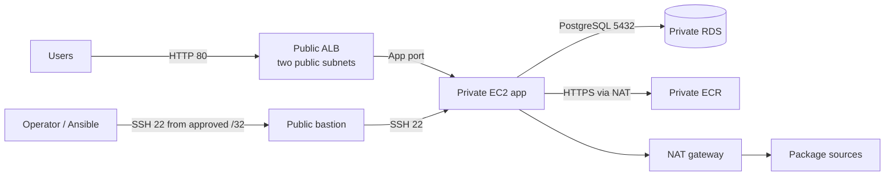

# SomaQuiz AWS infrastructure

Terraform provisions the Summative AWS foundation: a VPC, a private application VM, a public bastion, a public application load balancer, private PostgreSQL on RDS, and a private ECR repository. Networking, compute, database, registry and edge resources are separated into small modules.



## Security and operating choices

- The application VM has no public IP. The ALB is its only web ingress; SSH reaches it through the bastion.
- RDS sits in isolated private subnets and accepts PostgreSQL only from the application security group. RDS generates the master password and stores it in Secrets Manager. Terraform outputs only the secret ARN.
- The app instance role can pull images only from this ECR repository. ECR uses immutable tags, push scanning, encryption at rest, and a small lifecycle policy.
- Both instances require IMDSv2 and use encrypted gp3 root disks. SSH is limited to the configured operator `/32` addresses.
- One NAT gateway keeps private hosts able to download OS packages and images while avoiding one NAT per AZ. The app and RDS are single-instance lab services, not highly available production tiers.
- The public endpoint uses HTTP because no domain or TLS certificate is part of this repository. Restrict `web_cidrs` if the demo does not need public access.
- The current quiz API loads questions in memory. RDS is provisioned for the Summative architecture; the application does not yet consume it.

The NAT gateway, load balancer, two EC2 instances, RDS, storage and public IPv4 addresses can incur AWS charges. Review the plan and current AWS pricing before applying. Do not leave the lab running when it is not needed.

## Prerequisites and local inputs

Install Terraform 1.7+, AWS CLI and OpenSSH. Use an AWS profile with permissions to create the resources in the plan. Generate or select an SSH key pair; keep the private key outside this repository.

From the repository root in PowerShell:

```powershell
Copy-Item terraform/example.tfvars terraform/terraform.tfvars
notepad terraform/terraform.tfvars
```

Set `aws_region` to the AWS region you chose and `ssh_cidr` to the public IPv4 address of the Ansible controller or operator in `/32` notation. Set `ssh_public_key_path` if your public key is not `~/.ssh/somaquiz.pub`. Add each teammate who needs bastion access to both `additional_ssh_cidrs` and `additional_ssh_public_key_paths`. These values and key files are local and ignored by Git. Never add a private key or AWS credential to Terraform variables or this repository.

`web_cidrs` defaults to `0.0.0.0/0` so the demo URL is reachable publicly. Set it to a smaller CIDR set when appropriate. The CIDR input must be `/16` through `/21` so Terraform can divide the VPC into five `/24` subnets.

## Initialize, validate and plan

Run in `terraform/`. Configure AWS credentials first; the example below checks which account Terraform would use.

```powershell
cd terraform
terraform init
terraform fmt -check -recursive
terraform validate
terraform test

$env:AWS_PROFILE = "your-profile"
aws sts get-caller-identity
terraform plan -out=somaquiz.tfplan
terraform show somaquiz.tfplan
```

Confirm the returned AWS account is the intended one. Review every proposed create, update and replacement. This configuration moves the previous public application instance into a private subnet, so an existing app VM is expected to be replaced. The current VPC and original public subnet are kept at their existing Terraform addresses where possible. Do not apply a plan that proposes deleting resources or data you need to retain.

After reviewing and approving the plan, apply it:

```powershell
terraform apply somaquiz.tfplan
terraform output
```

Terraform state and saved plans can contain sensitive infrastructure details. Keep `terraform.tfstate`, backups, `.tfvars` files and `.tfplan` files private; the repository ignores them. This lab uses local state. For shared team use, migrate to an encrypted, versioned remote backend with locking.

## Outputs and Ansible connection

`application_url` is the public ALB URL. `ecr_repository_url` is the image destination. `app_private_ip`, `bastion_public_ip`, `app_instance_id`, and `ssh_user` are the Ansible connection values. `database_endpoint`, `database_port`, and `database_master_secret_arn` expose the private DB location and its managed credential reference without exposing the password.

SSH to the private host through the bastion (use the same key pair configured in Terraform):

```powershell
$bastion = terraform output -raw bastion_public_ip
$app = terraform output -raw app_private_ip
ssh -J "ubuntu@$bastion" "ubuntu@$app"
```

The Ansible inventory must target `app_private_ip` and set `ProxyJump` to the bastion. The colleague completing Part 2 should adapt the current static/dynamic inventory, which targets a public app host. The API must bind to `0.0.0.0` on the configured container port so the ALB can reach it. Terraform's `ansible_vars` output contains the non-secret host, port and bastion values.

The ALB health check calls `/ready` and considers HTTP 200 healthy. After Part 2 deploys the container, verify `application_url` and check target health in the EC2 console. The managed database password is available only through the AWS-generated Secrets Manager secret; grant application access only if the service later needs it.

## Cleanup

Review the destruction plan before cleanup. Destroying RDS discards its data because this coursework stack skips a final snapshot. ECR deletion is blocked while images remain unless `force_delete_ecr = true` is deliberately enabled.

```powershell
terraform plan -destroy
terraform destroy
```
